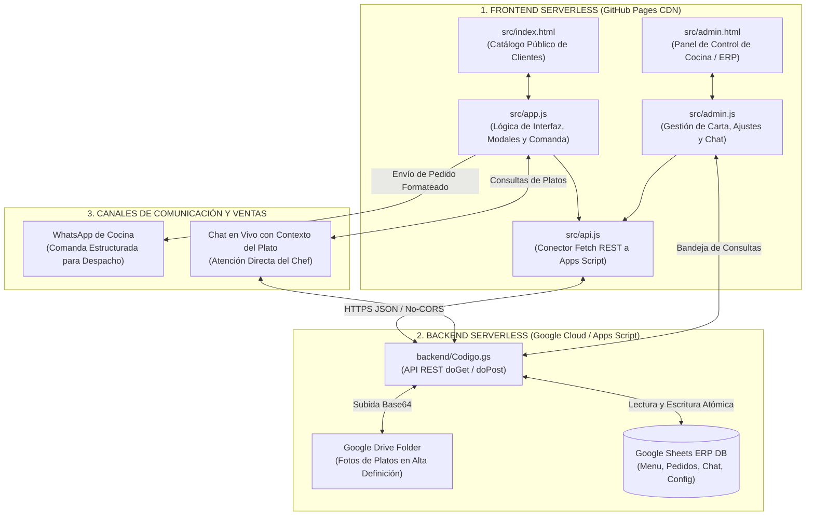

# 🍽️ A Domicilio — Manual Maestro de Arquitectura, Lógica y Funcionamiento

> **DOCUMENTO DE INDUCCIÓN Y REFERENCIA TÉCNICA PARA IAs Y DESARROLLADORES**  
> Este documento explica el 100% del funcionamiento, la arquitectura, los componentes y la lógica de negocio de la plataforma **A Domicilio**. Cualquier inteligencia artificial o programador que lea este archivo podrá comprender, auditar, mantener y extender el proyecto sin romper ninguna funcionalidad preexistente.

---

## 📌 1. Ficha Técnica y Enlaces Oficiales del Sistema

| Parámetro | Detalle Oficial |
| :--- | :--- |
| **Nombre Comercial** | **A Domicilio** (Comida Rápida, Caliente y Criolla) |
| **Propietario / Arquitecto** | **Humberto / ANDY Paz** |
| **Cuenta Propietaria Google Cloud** | `elchichote@gmail.com` |
| **Cuenta de Contacto del Negocio** | `inghumbertoacosta@gmail.com` |
| **Catálogo Público en Vivo (Clientes)** | [https://domicilio-chi.github.io/Domicilio/](https://domicilio-chi.github.io/Domicilio/) |
| **Panel de Administración en Vivo** | [https://domicilio-chi.github.io/Domicilio/admin.html](https://domicilio-chi.github.io/Domicilio/admin.html) |
| **Repositorio GitHub Oficial** | [https://github.com/Domicilio-Chi/Domicilio](https://github.com/Domicilio-Chi/Domicilio) |
| **ID Hoja de Cálculo ERP (Google Sheets)**| `1nHy2HPQEqdum2g1pXAyz6eJECVX4zgIPAt8J5JZqsRA` |
| **URL Web App (Google Apps Script)** | `https://script.google.com/macros/s/AKfycbyXnJXQEF0XsUVRd9w_oY_iekqD3H77FpJkspmIzavtGiCe9iMcjLfP9cI-5ewYD8kpSw/exec` |
| **Token Personal de Despliegue** | Almacenado en `domicilio_token.txt` (acceso a repositorio `Domicilio-Chi/Domicilio`) |

---

## 🗺️ 2. Arquitectura General del Sistema y Flujo de Datos



---

## 📂 3. Mapa y Estructura Completa de Archivos

```text
c:\Users\x\Desktop\WebViewComida\
│
├── 📄 README.md                        # ESTE DOCUMENTO (Guía maestra y mapa de lógica para IAs)
├── 📄 HISTORIAL.md                     # Bitácora cronológica exhaustiva de todas las sesiones de trabajo
├── 📄 PLAN_MAESTRO_PROYECTO_COMIDA.md  # Plan de requerimientos, fases aprobadas y matrices de calidad
├── 📄 domicilio_token.txt              # Credencial de GitHub con permisos de commit y push a la rama main
│
├── 📁 src/                             # CÓDIGO FUENTE ACTIVO DE DESARROLLO
│   ├── index.html                      # Catálogo público, splash 2.5s, buscador colapsable, modales, footer
│   ├── app.js                          # Lógica completa del cliente (comanda, delivery gratis, chat, categorías)
│   ├── admin.html                      # Interfaz del administrador (tabla de platos, ajustes, chat, métricas)
│   ├── admin.js                        # Lógica administrativa (persistencia, edición rápida, modal ajustes)
│   └── api.js                          # Conector API REST a Google Apps Script con endpoints y fallbacks
│
├── 📁 comida_gh_pages/                 # CARPETA DE DESPLIEGUE EN PRODUCCIÓN (GitHub Pages)
│   ├── index.html                      # Archivo de entrada público sincronizado con src/index.html
│   ├── 404.html                        # SPA Fallback (copia idéntica de index.html para soportar rutas directas)
│   ├── app.js                          # Script sincronizado con src/app.js (versión activa con cache buster)
│   ├── admin.html                      # Panel de administración desplegado en vivo
│   ├── admin.js                        # Lógica de administración desplegada en vivo
│   ├── api.js                          # Conector API en producción
│   └── README.md                       # Copia de la guía maestra para visualización directa en GitHub
│
├── 📁 backend/                         # CÓDIGO DEL SERVIDOR EN LA NUBE (Google Apps Script)
│   ├── Codigo.gs                       # Código Apps Script implementado como Web App pública
│   └── estructura_hojas.json           # Estructura formal de columnas para cada hoja de Google Sheets
│
├── 📁 docs/                            # DOCUMENTACIÓN TÉCNICA ADICIONAL
│   ├── INDICE_ARQUITECTURA.md          # Diagramas y flujos de datos específicos
│   ├── GUIA_VINCULACION_GOOGLE_SHEETS.md # Manual paso a paso para Apps Script y permisos de Drive
│   └── REGLAS_DE_GOBERNANZA.md         # Reglas inmutables de desarrollo y no-regresión
│
├── 📁 assets/                          # RECURSOS VISUALES
│   └── imagenes/                       # Fotografías de estudio culinarias optimizadas para comida
│       ├── empanadas_doradas.jpg
│       ├── pastelitos_guasacaca.jpg
│       ├── tequenos_guasacaca.jpg
│       ├── sopa_costilla_arepitas.jpg
│       ├── cachapa_queso_mano.jpg
│       └── refrescos_desayuno.jpg
│
├── 📁 capturas/                        # EVIDENCIAS DE PRUEBAS VISUALES AUTOMATIZADAS
│   ├── mejora_01...mejora_20.png       # Capturas tomadas por Chrome DevTools Protocol en vivo
│
└── 🧪 SCRIPTS DE AUTOMATIZACIÓN Y PRUEBAS EN VIVO (Chrome CDP puerto 9222)
    ├── test_splash_tarjeta_email.js    # Suite de prueba: Splash 2.5s, clic en tarjeta, botón compartir, footer
    ├── test_buscador_chat_categorias.js# Suite de prueba: Buscador colapsable, sugerencias, chat azul/blanco
    └── test_nuevas_funciones_completas.js # Suite de prueba: Chat contextual, admin ajustes, guía de categorías
```

---

## ⚙️ 4. Explicación Detallada de la Lógica de Negocio

### 4.1. Splash de Presentación Asíncrono (2.5 Segundos) — Cero Bloqueo
* **Problema resuelto:** Los comensales requerían una bienvenida gastronómica atractiva ("¡El mejor sabor criollo directo a tu mesa!"), pero los intentos previos congelaban el navegador.
* **Mecanismo de ingeniería:**
  1. El menú y las categorías se renderizan **inmediatamente** en el DOM subyacente.
  2. El elemento `#splashPresentacion` se coloca como un overlay `fixed inset-0 z-[100]` con desenfoque de fondo y tarjeta con gradiente cálido.
  3. Contiene una barra de progreso lineal de 2.4 segundos y un botón `[Entrar ya ➔]` para omitir instantáneamente.
  4. A los 2.5 segundos, una función no-bloqueante activa `opacity-0 pointer-events-none scale-95`.
  5. 500 ms después (al terminar la transición GPU), ejecuta `splash.style.display = 'none'`, desacoplándolo por completo del flujo de eventos del navegador.

### 4.2. Buscador Colapsable con Sugerencias Interactivas Abajo
* **Problema resuelto:** La barra de búsqueda fija ocupaba más de 50 px de altura en teléfonos celulares para una función que no siempre se utiliza.
* **Mecanismo:**
  1. En la fila de botones superiores se colocó el botón **`[🔍]`** (`#btnToggleBuscador`).
  2. Al tocarlo, abre el panel desplegable `#panelBuscadorColapsable` con autoenfoque.
  3. **Sugerencias populares:** Si el input está vacío, muestra botones rápidos: `🥟 Empanadas`, `🧀 Tequeños`, `🌽 Cachapas`, `🍲 Sopa de Costilla`, `🍔 Hamburguesa`, `🥤 Bebidas`.
  4. **Coincidencias en tiempo real:** Al escribir texto, lista los platos que coinciden con su ícono y precio. Al tocar cualquier sugerencia, abre directamente la ficha del plato.
  5. Al pulsar `[Cerrar]` o la lupita de nuevo, se pliega y desaparece, manteniendo la cabecera en una sola fila compacta.

### 4.3. Tarjetas del Menú 100% Clickeables (Toda la Paleta es Interactiva)
* **Problema resuelto:** Solo la foto abría el plato; hacer clic en el nombre o descripción no tenía efecto, y los botones redundantes recargaban la cuadrícula.
* **Mecanismo:**
  1. El contenedor exterior de cada plato (`<div onclick="abrirModalPlato('${p.id}')" ... class="... cursor-pointer ...">`) es el único disparador táctil.
  2. Tocar cualquier punto (foto, título, ingredientes, precio o fondo) abre la ficha del plato.
  3. Se eliminaron los botones redundantes `[Pedir / Extras]` y `[Compartir]`.
  4. Sobre la foto se muestra el Nombre del plato a la izquierda y el Precio a la derecha.
  5. En el pie de cada tarjeta se muestra: `Toca para ver extras y pedir ➔` y `🔥 Recién hecho`.

### 4.4. Ficha del Plato y Selección de Adicionales (`#modalPlato`)
* Al abrir un plato, se carga:
  * Foto grande y optimizada para pantallas móviles.
  * Título, descripción e ingredientes.
  * **Botón Compartir en la cabecera:** En la esquina superior derecha, junto a la `[X]`, se ubica el botón `[🔗]` para compartir por WhatsApp o copiar el enlace directo.
  * **Lista de Adicionales / Extras:** Checkboxes con precio que recalculan el total automáticamente al ser seleccionados (ej: salsas extra, ración de aguacate, doble queso).
  * **Notas de Cocina:** Campo opcional para instrucciones personalizadas (ej. *"salsa verde aparte"*, *"arepita bien tostada"*).
  * **Botón "¿Tienes dudas? Consulta al chef sobre este plato":** Abre el Chat Web etiquetando automáticamente el plato consultado.
  * **Control de cantidad y botón "Agregar a Comanda":** Suma el plato personalizado al carrito de compras local.

### 4.5. Motor de Comanda y Despacho WhatsApp con Promoción de Delivery Gratis
* **Cálculo de Delivery Gratis:**
  * Configurable dinámicamente desde el panel de administración (por defecto: gratis a partir de 2 unidades).
  * En el modal de comanda (`#modalComanda`), un banner reactivo indica:
    * Si faltan platos: `🛵 Agrega 1 plato más y obtén Delivery GRATIS`.
    * Si califica: `🎉 ¡Tu pedido califica para Delivery GRATIS!`.
* **Despacho Automático a Cocina:**
  1. Al pulsar `[Confirmar y Enviar Pedido a Cocina 📲]`, se compila un mensaje de WhatsApp perfectamente estructurado con:
     * Nombre del comensal, teléfono, dirección y punto de referencia.
     * Lista numerada de platos con sus extras e instrucciones de cocina.
     * Total en USD y desglose del costo de delivery (GRATIS o Estándar).
     * Método de pago seleccionado (Pago Móvil, Zelle, Efectivo USD, Tarjeta).
  2. Envía la comanda en segundo plano al ERP de Google Sheets (`accion=registrarComanda`).
  3. Abre automáticamente la conversación de WhatsApp con la línea oficial de cocina.
  4. Vacía la comanda local y actualiza los badges visuales.

### 4.6. Chat Web en Vivo con Contexto del Plato y Auto-Respuesta del Chef
* En la cabecera del chat (`#modalChat`), si el cliente consultó desde un plato, se despliega:  
  `Consultando: [Nombre del Plato] ($[Precio])`.
* Incluye chips de preguntas frecuentes de 1 clic:
  * `⏱️ ¿Cuánto tarda?`
  * `🌶️ ¿Trae salsas?`
  * `🛵 ¿Entrega inmediata?`
* El mensaje se registra en Google Sheets `Mensajes_Chat`.
* A los 900 ms, un asistente inteligente de cocina responde automáticamente informando el tiempo de despacho estimado e incluye el botón directo `[📲 Confirmar por WhatsApp]`.
* **Efecto visual del botón de chat en cabecera:** El ícono y sus bordes fluctúan rítmicamente entre azul eléctrico (`#0284c7`) y blanco puro (`#ffffff`), con un leve pulso para atraer consultas sin ser invasivo.

### 4.7. Selector de Categorías en Móvil con Onda Suave
* En teléfonos móviles, las categorías se despliegan con nombres compactos en una sola pista horizontal con desplazamiento táctil suave:  
  `Todos` | `Desayunos` | `Sopas` | `Cachapas` | `Rápida` | `Bebidas`.
* Cada 1.8 segundos, una animación suave de onda (`categoria-guia-suave`) eleva y resalta suavemente las categorías una por una para guiar la atención del usuario. Si un botón queda fuera del margen de la pantalla del celular, se desplaza automáticamente a la vista (`scrollIntoView`).

### 4.8. Sistema Dual de Tema (Modo Claro ☀️ / Modo Oscuro 🌙)
* Por defecto, la tienda inicia en **Modo Claro** (blanco marfil con contrastes limpios).
* Si el usuario pulsa el botón Sol/Luna en la cabecera, conmuta a **Modo Oscuro** (fondo carbón profundo `#0C0A09` con acentos ámbar apetitosos).
* La preferencia se almacena en `localStorage.getItem('adomicilio_tema')`.
* Un micro-script en el `<head>` previene cualquier parpadeo de color durante la carga (Anti-FOUC).

### 4.9. Panel de Administración y ERP (`admin.html`)
* **Gestión de Carta:** Tabla interactiva para ajustar precios en tiempo real o pausar platos que se hayan agotado en la cocina.
* **Subida de Platos:** Modal para crear nuevos platos con foto alojada automáticamente en Google Drive.
* **Bandeja de Consultas de Clientes:** Ventana modal que muestra las preguntas entrantes de los clientes en la web, identificando sobre qué plato están preguntando y con un botón para responder directo por WhatsApp.
* **Ajustes Generales (`#modalConfigGeneral`):**
  * **Categoría Predeterminada:** Permite fijar qué categoría ven los usuarios al entrar (ej. abrir directamente en Cachapas o Desayunos).
  * **Correo de Contacto:** Campo para configurar el correo del pie de página (`inghumbertoacosta@gmail.com`).
  * **Líneas de WhatsApp:** Configuración del número principal de cocina y el secundario de repartidores.
  * **Promoción Delivery Gratis:** Interruptor de activación, número de unidades mínimas, texto de la píldora y condiciones detalladas.

---

## 🗄️ 5. Esquema de Base de Datos (Google Sheets ERP)

El libro de Google Sheets oficial (ID: `1nHy2HPQEqdum2g1pXAyz6eJECVX4zgIPAt8J5JZqsRA`) contiene las siguientes 5 pestañas:

### 1. `Menu_Platillos`
| Columna | Tipo | Descripción |
| :--- | :--- | :--- |
| `ID_Plato` | String | Código único (ej. `D01`, `A01`, `C01`, `R01`) |
| `Nombre` | String | Nombre del plato (ej. *"Cachapa Tradicional con Queso de Mano"*) |
| `Categoria` | String | `Desayunos`, `Almuerzos`, `Cachapas`, `Comida Rápida`, `Bebidas` |
| `Descripcion` | String | Ingredientes y descripción apetitosa |
| `Precio_USD` | Number | Precio base en dólares americanos |
| `Disponibilidad` | Boolean | `true` (activo en menú) / `false` (agotado) |
| `URL_Foto` | String | Enlace directo a la imagen en Google Drive o assets locales |
| `Extras_JSON` | String | JSON array con opciones adicionales y sus precios |
| `Fecha_Actualizacion`| String | Marca temporal del último cambio |

### 2. `Pedidos_Comanda`
| Columna | Tipo | Descripción |
| :--- | :--- | :--- |
| `ID_Comanda` | String | Código único generado (ej. `CMD-1042`) |
| `Timestamp` | Datetime | Fecha y hora exacta de recepción |
| `Nombre_Cliente` | String | Nombre completo del comensal |
| `Telefono_Cliente`| String | Número de teléfono o WhatsApp |
| `Direccion_Entrega`| String | Dirección exacta y punto de referencia |
| `Platos_Detalle` | String | Resumen legible de platos pedidos y cantidades |
| `Extras_Detalle` | String | Resumen de adicionales seleccionados |
| `Instrucciones_Cocina`| String | Notas especiales para el chef |
| `Total_USD` | Number | Monto total a cobrar |
| `Estado` | String | `Recibida en Cocina`, `En Preparación`, `En Camino`, `Entregada` |

### 3. `Mensajes_Chat`
| Columna | Tipo | Descripción |
| :--- | :--- | :--- |
| `ID_Mensaje` | String | Identificador del mensaje |
| `Timestamp` | Datetime | Fecha y hora |
| `ID_Sesion_Cliente`| String | ID de sesión anónima o identificada |
| `Nombre_Cliente` | String | Nombre del comensal o `Cocina A Domicilio (Chef)` |
| `Emisor` | String | `cliente` o `admin` |
| `Mensaje` | String | Texto enviado (incluye etiqueta `[Consulta: Plato]`) |
| `Leido` | Boolean | Indicador de lectura |

### 4. `Clientes_Comensales`
| Columna | Tipo | Descripción |
| :--- | :--- | :--- |
| `ID_Cliente` | String | Identificador de cliente recurrente |
| `Nombre` | String | Nombre |
| `Telefono` | String | WhatsApp |
| `Direccion_Frecuente`| String | Dirección habitual |
| `Total_Pedidos` | Number | Contador de comandas |
| `Ultimo_Pedido` | Datetime | Fecha de la última compra |

### 5. `Configuracion`
| Columna | Tipo | Descripción |
| :--- | :--- | :--- |
| `Clave` | String | Identificador del parámetro (ej. `categoria_predeterminada`, `email_contacto`, `delivery_min_unidades`) |
| `Valor` | String | Valor guardado |
| `Descripcion` | String | Explicación del ajuste |
| `Fecha_Modificacion`| Datetime | Timestamp del cambio |

---

## 🚀 6. Protocolo de Despliegue y Sincronización

Cuando se realiza cualquier modificación en los archivos de desarrollo (`src/`):

1. **Editar siempre los archivos en `src/`:**
   * [`src/index.html`](file:///c:/Users/x/Desktop/WebViewComida/src/index.html)
   * [`src/app.js`](file:///c:/Users/x/Desktop/WebViewComida/src/app.js)
   * [`src/admin.html`](file:///c:/Users/x/Desktop/WebViewComida/src/admin.html)
   * [`src/admin.js`](file:///c:/Users/x/Desktop/WebViewComida/src/admin.js)
   * [`src/api.js`](file:///c:/Users/x/Desktop/WebViewComida/src/api.js)

2. **Incrementar el Cache Buster en `src/index.html`:**
   * Cambiar `?v=2.x` al nuevo número de versión para evitar problemas de caché en navegadores.

3. **Sincronizar a `comida_gh_pages/`:**
   ```powershell
   Copy-Item 'C:\Users\x\Desktop\WebViewComida\src\index.html' 'C:\Users\x\Desktop\WebViewComida\comida_gh_pages\index.html' -Force
   Copy-Item 'C:\Users\x\Desktop\WebViewComida\src\index.html' 'C:\Users\x\Desktop\WebViewComida\comida_gh_pages\404.html' -Force
   Copy-Item 'C:\Users\x\Desktop\WebViewComida\src\app.js' 'C:\Users\x\Desktop\WebViewComida\comida_gh_pages\app.js' -Force
   Copy-Item 'C:\Users\x\Desktop\WebViewComida\src\admin.html' 'C:\Users\x\Desktop\WebViewComida\comida_gh_pages\admin.html' -Force
   Copy-Item 'C:\Users\x\Desktop\WebViewComida\src\admin.js' 'C:\Users\x\Desktop\WebViewComida\comida_gh_pages\admin.js' -Force
   Copy-Item 'C:\Users\x\Desktop\WebViewComida\src\api.js' 'C:\Users\x\Desktop\WebViewComida\comida_gh_pages\api.js' -Force
   Copy-Item 'C:\Users\x\Desktop\WebViewComida\README.md' 'C:\Users\x\Desktop\WebViewComida\comida_gh_pages\README.md' -Force
   ```

4. **Comprometer y subir a GitHub Pages:**
   ```powershell
   cd 'C:\Users\x\Desktop\WebViewComida\comida_gh_pages'
   git add -A
   git commit -m "tipo(alcance): descripción precisa del cambio"
   git push origin main
   ```

---

## 🧪 7. Pruebas Automatizadas con Chrome DevTools Protocol (CDP)

El proyecto cuenta con scripts de prueba que se conectan al navegador en el puerto `9222`:

* **Verificación de Splash, Clics de Tarjeta y Footer:**
  ```powershell
  node C:\Users\x\Desktop\WebViewComida\test_splash_tarjeta_email.js
  ```
* **Verificación de Buscador, Sugerencias, Chat Azul/Blanco y Categorías:**
  ```powershell
  node C:\Users\x\Desktop\WebViewComida\test_buscador_chat_categorias.js
  ```
* **Verificación de Precios Inferiores, Fotos Reales y Sistema de Bebidas:**
  ```powershell
  node C:\Users\x\Desktop\WebViewComida\verificar_nuevas_mejoras_v32.js
  ```
* **Verificación de Título y Precio sobre la Imagen en Modal con Rellenos Opcionales:**
  ```powershell
  node C:\Users\x\Desktop\WebViewComida\test_modal_titulo_en_imagen.js
  node C:\Users\x\Desktop\WebViewComida\verificar_opciones_rellenos_opcionales.js
  ```
* **Capturas generadas:** Se guardan en [`capturas/`](file:///c:/Users/x/Desktop/WebViewComida/capturas/) y en el directorio de artefactos para revisión visual inmediata.

---

## 🛡️ 8. Reglas de Gobernanza para IAs y Nuevos Agentes

1. **NO reinventar la arquitectura:** El backend es Google Sheets + Apps Script y el frontend es HTML5 + Tailwind CSS vanilla + JS modular. No introducir frameworks pesados (React, Vue, Angular) a menos que Humberto lo solicite explícitamente.
2. **NO romper la identidad:** La cuenta oficial de Google es `elchichote@gmail.com` y el repositorio de GitHub es `Domicilio-Chi/Domicilio`. No alterar correos ni repositorios de terceros.
3. **NO bloquear el hilo de ejecución:** Cualquier animación introductoria debe ser asíncrona y desmontarse del DOM tras su tiempo de vida (`display: none`).
4. **NO desincronizar `comida_gh_pages`:** Cada cambio en `src/` debe ser reflejado en `comida_gh_pages/index.html` y `comida_gh_pages/404.html`.
5. **Registrar siempre en `HISTORIAL.md`:** Cada sesión de trabajo debe documentarse cronológicamente con sus commits y capturas de prueba.
